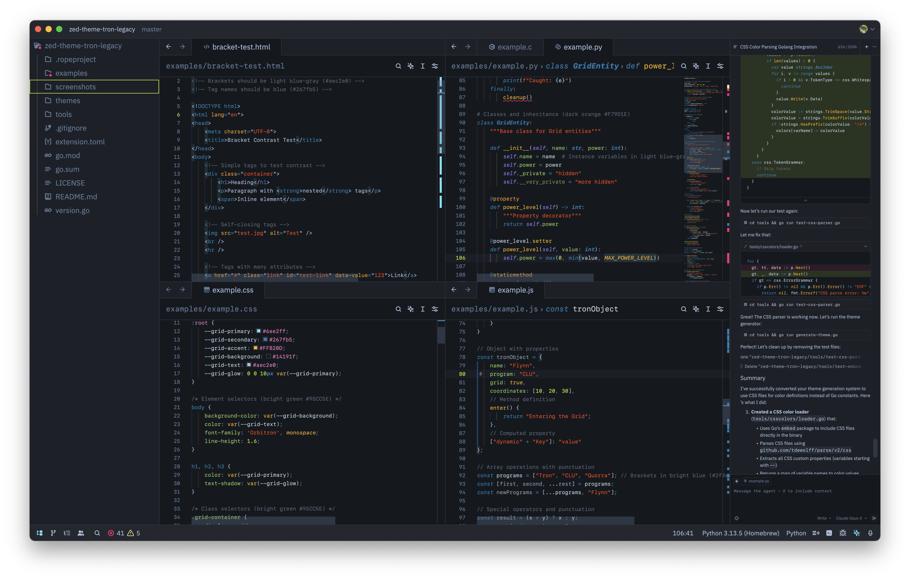
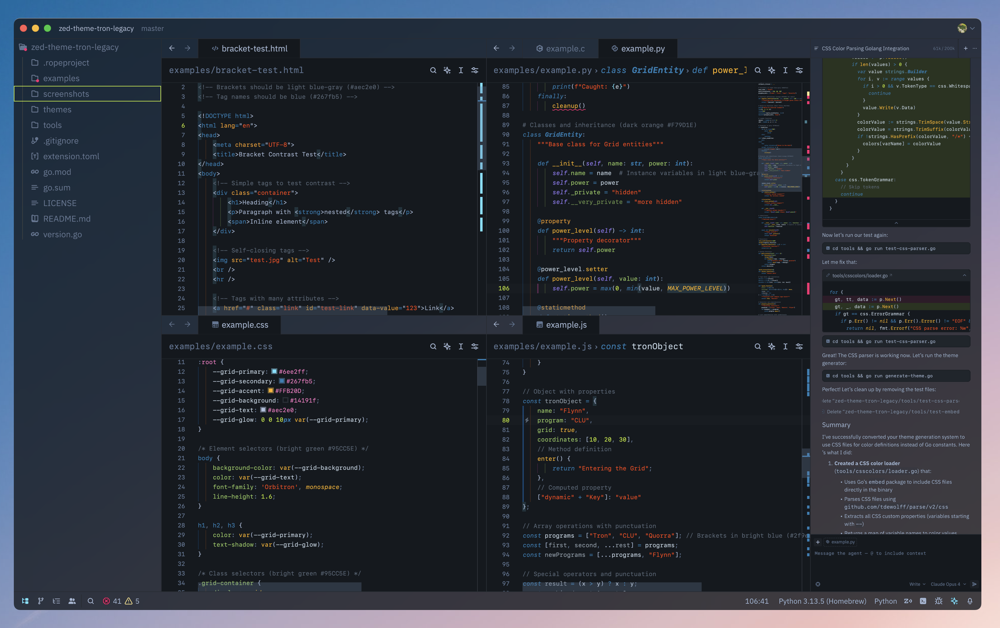
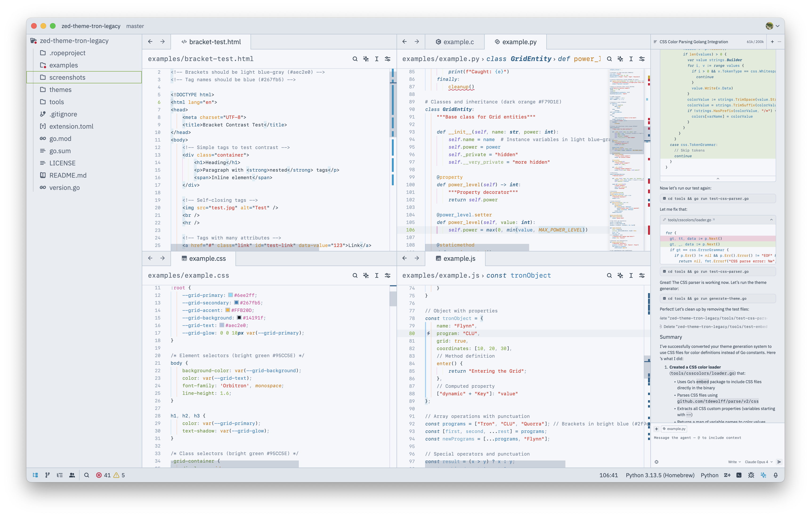
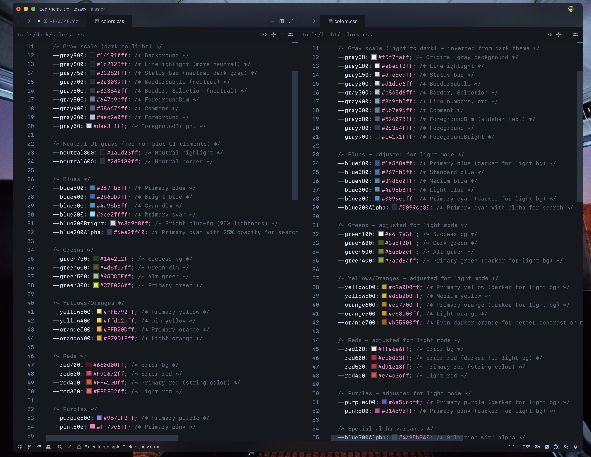

# Tron Legacy Theme for Zed

A port of the old Textmate theme "Tron Legacy" to Zed, with a new light mode and frosted variants.






## Features

- High contrast syntax highlighting optimized for readability
- Carefully selected colors that maintain WCAG contrast ratios
- Broad Zed UI and syntax coverage, checked against the official themes
- 🌝 Light and Dark variants 🌚
- 🥶 Frosted transparent variants ❄️

## Developing

To test and generate the theme run:

```console
make all
```

There are two color schemes: [`dark/colors.css`](./tools/dark/colors.css) and [`light/colors.css`](./tools/light/colors.css).
Both dark and light colors include frosted color variants.
The colors are defined in colors.css files as css variables so that zed can display in-line color previews.



The colors are loaded into [`palette.go`](./tools/dark/palette.go) and assigned to a semantic [`TronThemePalette`](./tools/palette/palette.go) mapping.
These semantic mappings are then fed into [`generator.go`](./tools/palette/generator.go) and the final output ends up in [`themes/tron-legacy.json`](./themes/tron-legacy.json).

## Upstream reconciliation

Last audited on **2026-10-21**, against Zed commit
[`59dd60d4dd3bd85cbdcf00328e689fa519b55f78`](https://github.com/zed-industries/zed/commit/59dd60d4dd3bd85cbdcf00328e689fa519b55f78).
The assumed previous reconciliation was Tron commit `3fd2b39d7a0769d5842e23d182f9a4a88bc6e634`
(2026-08-10). This records the local checkout audited, not a claim about the latest remote release.

The audit covered One, Gruvbox, and Ayu; Zed's serialized theme properties and
runtime fallbacks; all 23 built-in language highlight queries; and default and
language-specific semantic-token rules. There were no official-theme JSON changes
since the assumed baseline. The repaired gaps predated that baseline:

- Moved accents into `style.accents`, where Zed actually reads them.
- Removed ignored `foreground` and `editor.selection.background` properties.
  Existing editor selections remain controlled by `style.players`.
- Added Tron-colored drop-target borders and translucent word-diff highlights.
- Covered every official syntax selector and added semantic parameter/modifier/built-in
  constant styles, Rust lifetimes, C++ concepts/modules, and Git commit headings/links/deltas.
- Added the semantic `string.regexp` spelling alongside Tree-sitter's `string.regex`.

Some supported properties intentionally rely on Zed's fallbacks:

- CodeLens uses `text.muted`; its dedicated property was added upstream on 2026-09-11.
- Diff-hunk backgrounds/borders derive from Tron's added/deleted colors and appearance.
- UI text selections use the local player's selection color. The historical explicit
  `element.selection_background` override remains disabled pending visual retesting.
- Vim/Helix mode badges retain Zed's default treatment; yank and jump-label colors
  inherit the theme's document highlight and error colors.
- Active search matches explicitly use the existing search highlight color.
- Frosted variants retain `blurred`; the newer Windows Mica appearances are not enabled.

Tree-sitter selectors inherit dotted prefixes, while semantic-token styles use exact
names. Internal helper captures are not styled. Markdown's `strikethrough.markup`
cannot express actual strikethrough through the current theme JSON style fields.
Third-party language extensions may introduce additional selectors; this audit does
not guarantee coverage of every extension. Rendering and contrast still need visual
review, especially for translucent variants.

To check against a local Zed checkout from this repository's root:

```console
make generate
ZED_SOURCE_DIR=/absolute/path/to/zed go test -count=1 ./...
```

The optional upstream test checks the union of official theme style properties and
syntax selectors across all four Tron variants. Ordinary tests also check the repaired
properties and that the checked-in JSON matches the generator. The schema-validation
test downloads the published schema; the upstream comparison itself is local-only.
The official-theme comparison does not detect every new schema field or language
capture: for future reconciliations, also review changes since the recorded Zed commit
in `crates/settings_content/src/theme.rs`, `crates/theme_settings/src/schema.rs`,
`crates/theme/src`, `crates/grammars/src`, `assets/settings/default_semantic_token_rules.json`,
and `crates/syntax_theme/src` before updating this baseline.

## See also

- [tron-legacy-vscode](https://github.com/bcomnes/tron-legacy-vscode)
- [sublime-tron-color-scheme](https://github.com/bcomnes/sublime-tron-color-scheme)
- [Tron.tmbundle](https://github.com/bcomnes/Tron.tmbundle) - The orginal

## Acknowledgments

Thank you Dayle Rees and Tim Heckman, the original creators of this fantastic theme. Thank you ColorSublime for helping put so many fantastic color schemes out into the world.

## License

MIT License - See [LICENSE](LICENSE) file for details
